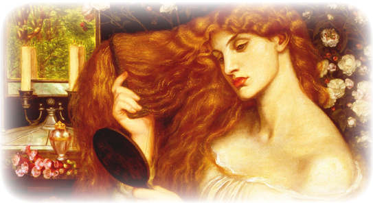
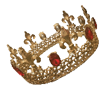
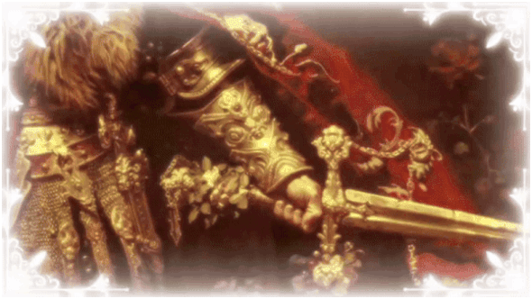
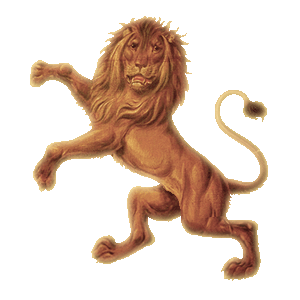
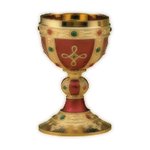

  

  

  

  

  
  

  
textextext

  

  
  

  

  
 
$\small\color{white}\text{ . qngely  . made for ponytown }$

　
$\small\color{white}\text{"   he/him   ! "}$𓈒
　

  
$\small\color{white}\text{"ৎ୭　busy unless its the weekend.} $

  
$\small\color{white}\text{" friendly ! but please dont do anything in confusing or weird ways .  "}$𓈒 𓈒

  

  

    

   

 

  

  

⠀⠀

<!-- CENTERED QUOTE -->

  <i>" thank you for 30+ followers ! ."</i>

  $\small\color{white}\text{ "C+H freely! .".}$

$\small\color{white}\text{"I'm mostly busy so I probably won't be seen much anymore. ! "}$

  

<!-- markdownlint-disable MD033 MD041 -->

